# cliamp-web

**A retro terminal music player, 100% web-native.** Built to be driven by touch
from a car's in-car browser — landscape-first, big targets, no keyboard, no
backend.

A browser adaptation of [cliamp](https://github.com/bjarneo/cliamp) (the Go +
Bubbletea terminal player) to a static PWA: React + TypeScript + Vite +
zustand, with a real-time Web Audio engine (spectral visualizer, 10-band EQ,
pitch/time-stretch, gapless-style transitions) and a **subset of the Lua hook API** running in the browser.

**Web v0.2.0 tracks selected changes from cliamp v2.4.0** (November 5, 2026).
This is an independent implementation with substantial remaining gaps, not a
complete port. See the [feature parity audit](docs/feature-parity-v2.4.0.md) for
implemented behavior, broken provider contracts, missing features and evidence.
The exact native release and commit are recorded in [upstream.json](upstream.json).

An [opt-in Qobuz browser-only experiment](docs/qobuz-browser-test.md) is in
progress. It reuses native cliamp's public web-client bootstrap method, but
real-account authorization and playback remain unverified. It is hidden from
normal navigation until a session has been validated.

**Live: [keylimesoda.github.io/cliamp-web](https://keylimesoda.github.io/cliamp-web/)**

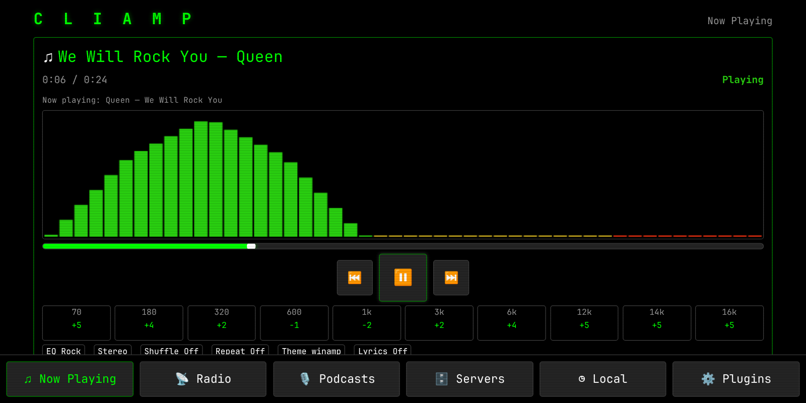

| | |
| --- | --- |
| 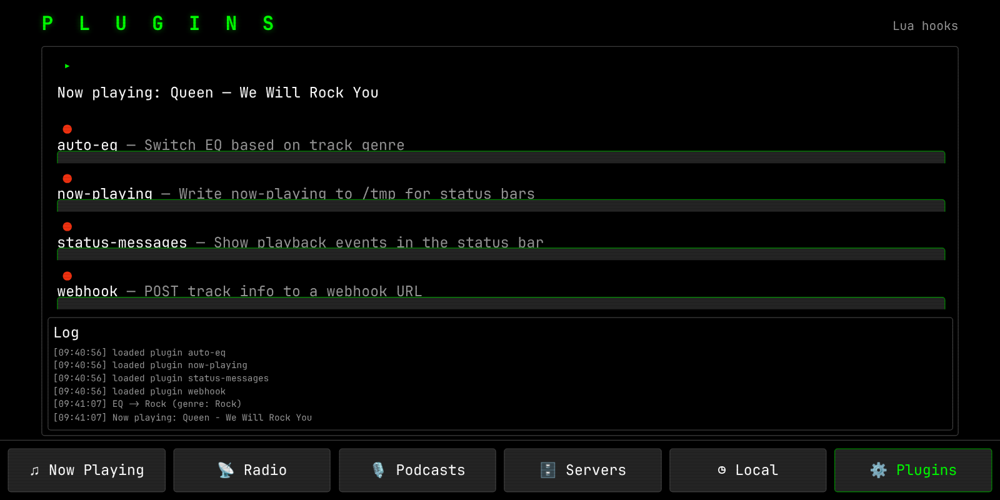 | 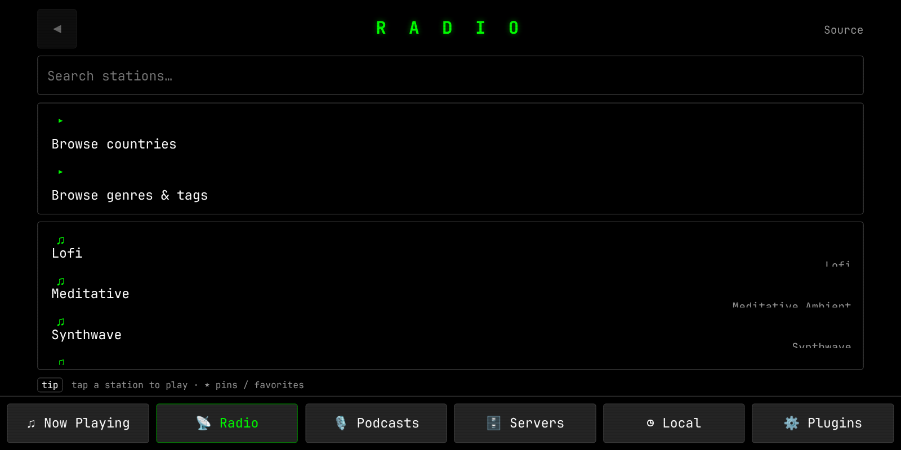 |
| Lua plugins with live log | Internet radio (Radio Browser) |
| 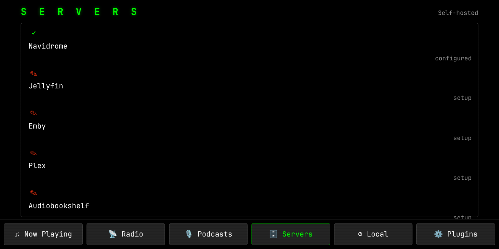 | 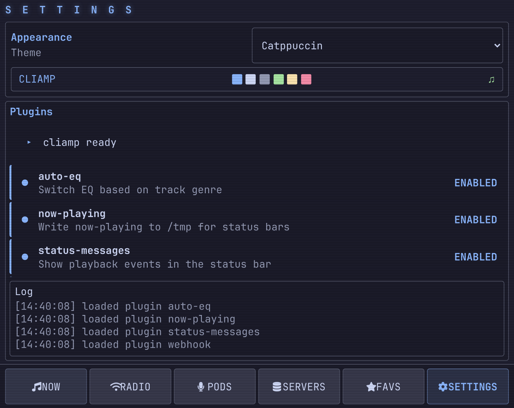 |
| Self-hosted music servers | Theme picker and plugins |

## Features

- **Now Playing** — touch transport (prev / play-pause / next), seek bar,
  a 10-band EQ with touch sliders, a preset picker and a saved custom curve, mono, shuffle/repeat,
  queue and playlist manager under **MORE → Queue**, and **34 real-time visualizer modes** — tap the
  visualizer to cycle modes.
- **Player volume** — under **MORE → Playback options**, with a reset to
  0 dB. Main and full-screen playback leave listening volume to the car.
- **Personal EQ** — open **MORE → EQ preset** to pick a curve. Drag an individual
  frequency slider up/down (−12 to +12 dB), then tap **Save custom EQ**.
  Choose **Saved custom EQ** in the picker to recall it after trying other presets.
  The saved curve stays in this browser across reloads; saving again replaces it.
  EQ requires audio that supports the browser DSP path; non-CORS streams bypass it.
- **v2.4 updates** — YinYang and Ethereal visualizers, named EQ preset selection,
  playlist reversal, current-track Navidrome ratings, radio channel song lists
  and listener counts, and corrected lyrics/Plex metadata.
- **Driving-friendly listening** — bounded connection recovery, per-episode and
  per-Audiobookshelf-file resume with a five-second rewind, played markers,
  editable play-next queue, and locally saved playlists.
- **Music sources**
  - **Radio** — Radio Browser (countries, genres/tags) + built-in preset stations.
  - **Podcasts** — Apple top charts, search, RSS enclosures.
  - **Self-hosted** — Navidrome (Subsonic), Audiobookshelf and [Plex](docs/plex.md),
    with connections verified before saving. Plex supports phone-code account
    linking, server discovery, music libraries, albums and audio playlists.
    Jellyfin, Emby and Lyrion remain hidden; see the [server sign-in audit](docs/server-auth-audit.md).
- **History & favorites** — recent plays (deduped) and a favorites list,
  persisted locally.
- **Lyrics** — LRCLIB lookup and LRC parsing, synced to playback.
- **Lua plugins** — a Lua 5.1-style interpreter in TypeScript; plugins hook
  `track.change`, `playback.state`, `track.scrobble`, `app.start`, control
  playback, read tracks, and surface status messages. Four bundled:
  `auto-eq` (genre→EQ preset), `now-playing` (browser storage), `status-messages`,
  `webhook`. See [docs/lua-plugins.md](docs/lua-plugins.md).
- **Themes** — choose any of the 22 bundled themes in **Settings → Appearance**.
  Changes apply immediately and are saved; the Theme button on Now Playing
  opens the picker directly. Plugins and their logs share the Settings screen.
- **PWA** — installable, service-worker app-shell caching, fullscreen
  landscape manifest.

## Visualizers

The 34 named visualizer modes from cliamp v2.4.0, adapted to a canvas
character-grid renderer. Algorithms and analysis are not all identical to native
cliamp (the Stereo meters use a mono tap). **Tap/click the visualizer to cycle** (the original's
`v` key); the choice persists. Rendering runs at ~60 FPS while playing and
throttles to ~5 FPS when idle.

| | |
| --- | --- |
| 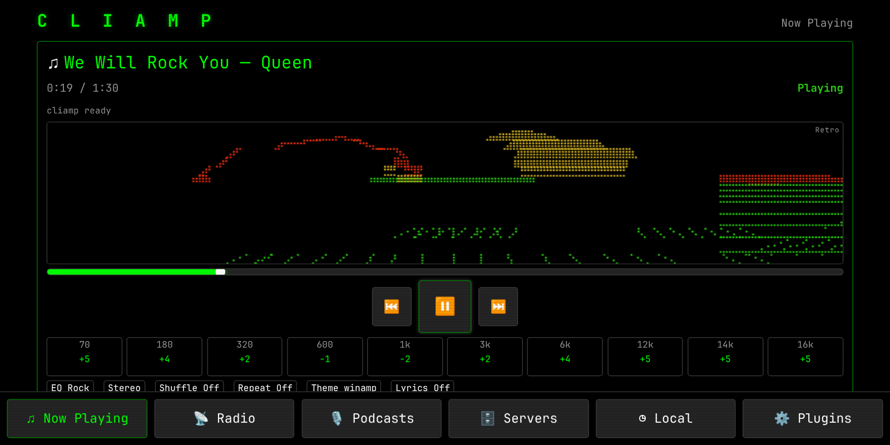 | 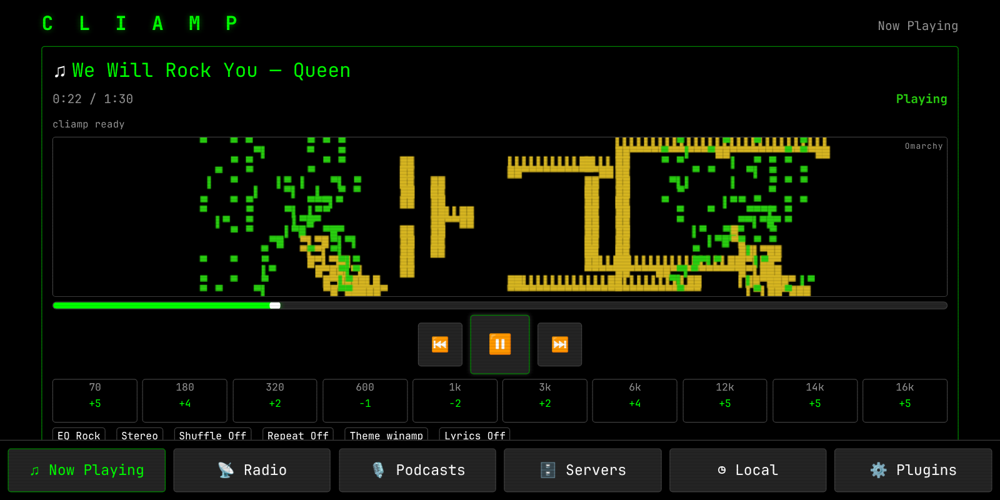 |
| 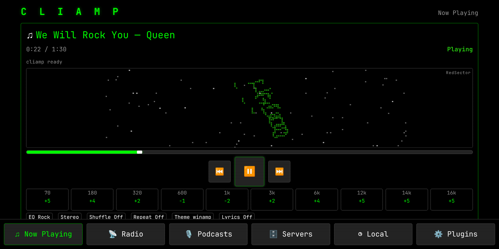 | 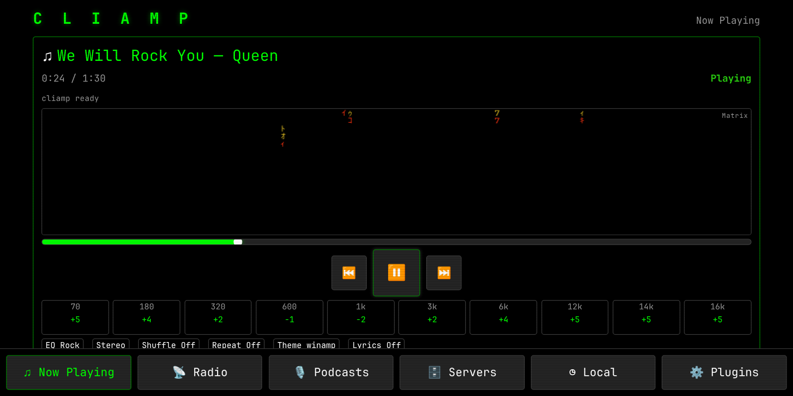 |
| 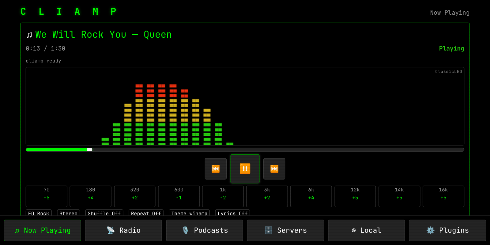 | 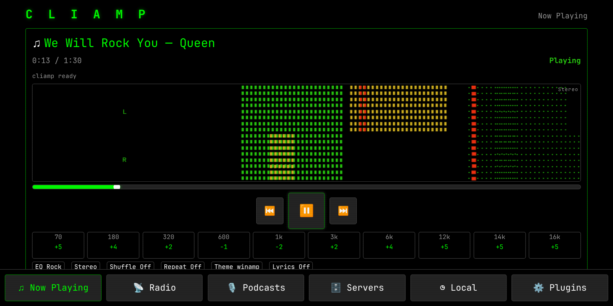 |
| 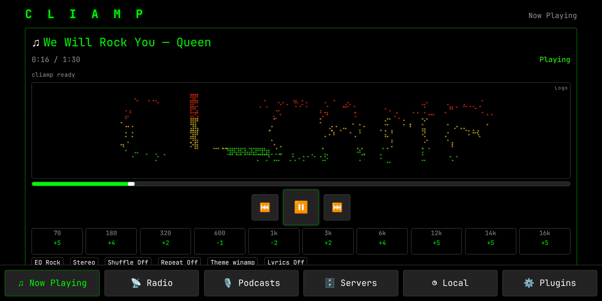 | 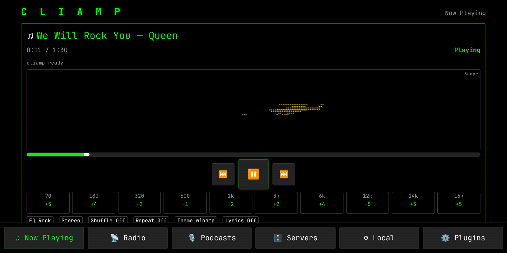 |
| 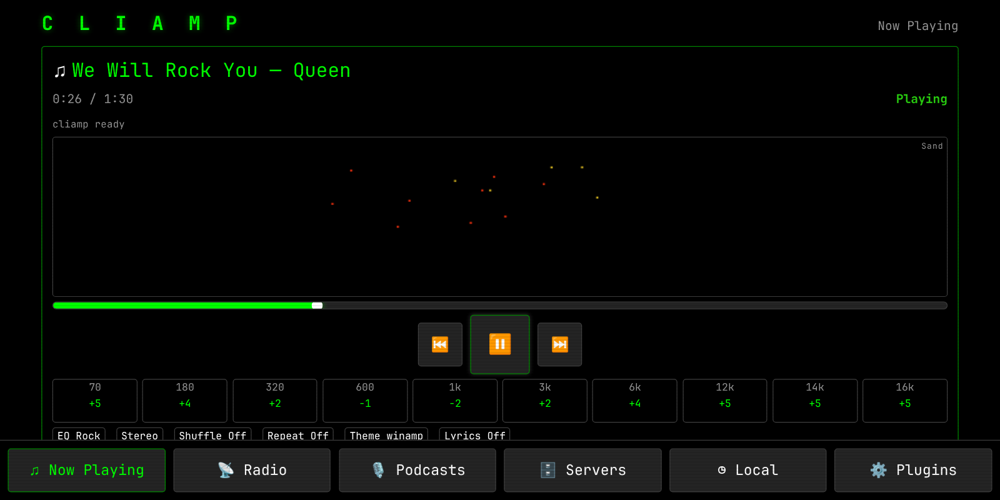 | 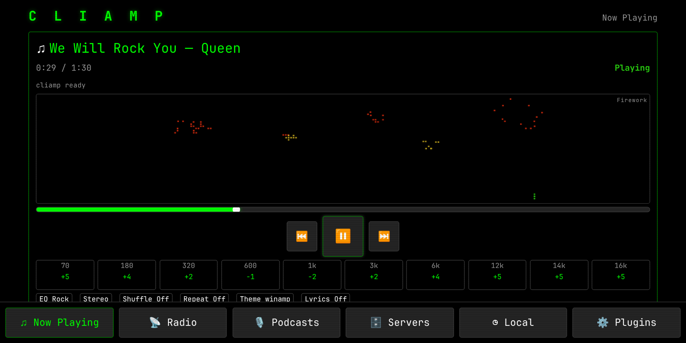 |
| 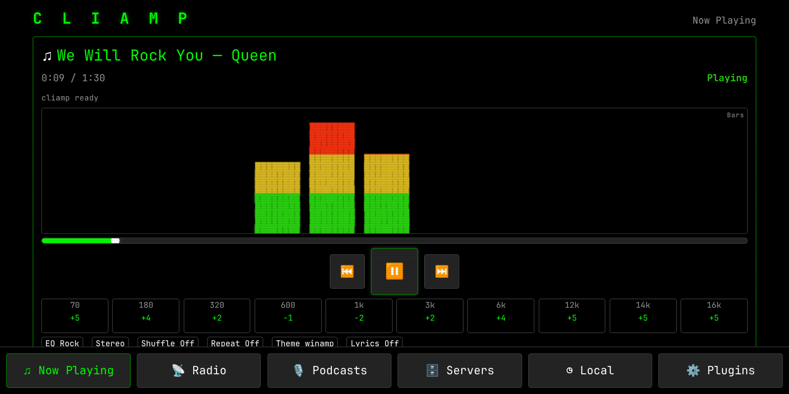 | |
| 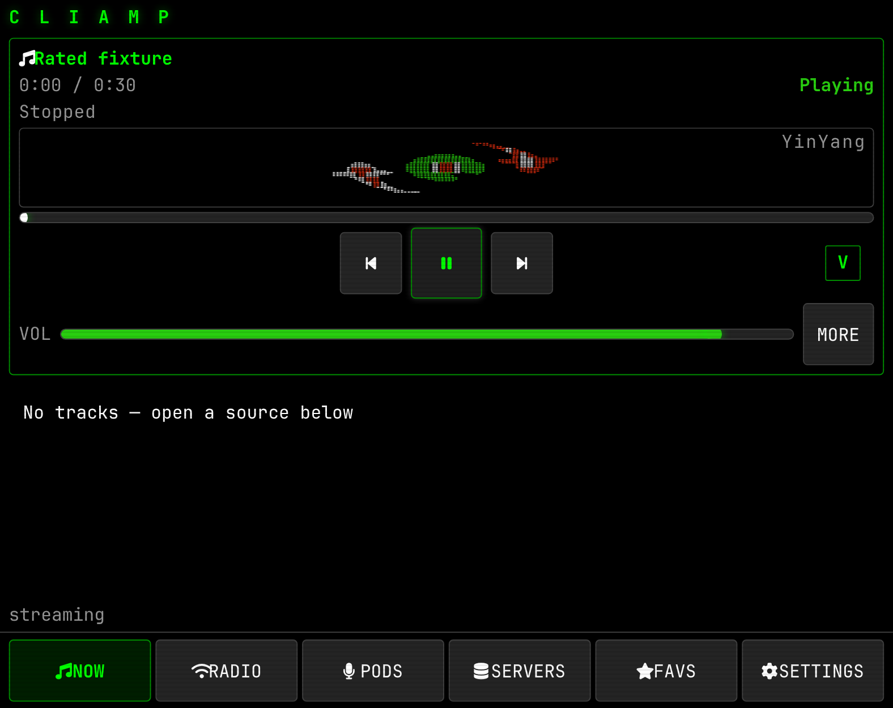 | 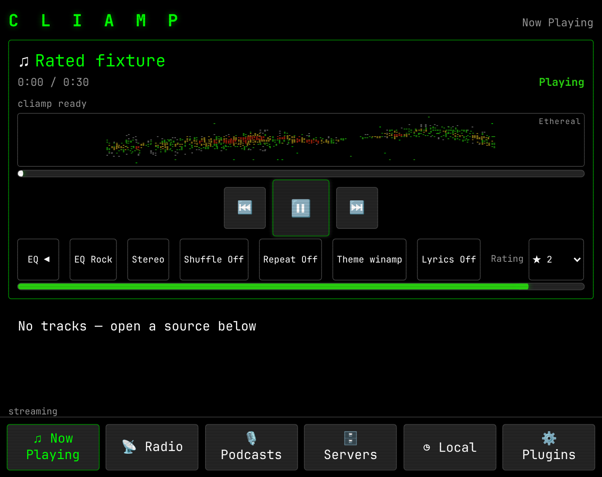 |

`Bars` `BarsDot` `Rain` `BarsOutline` `Bricks` `Columns` `ClassicPeak` `Wave`
`Scatter` `Flame` `Retro` `Pulse` `Matrix` `Binary` `Sakura` `Firework`
`Bubbles` `Logo` `Terrain` `Scope` `Heartbeat` `Butterfly` `Ascii` `Firefly`
`Mosaic` `Sand` `Geyser` `ClassicLED` `Stereo` `Mirror` `Omarchy` `RedSector`
`YinYang` `Ethereal`
(plus `None` to hide the visualizer).

## Quickstart

```sh
npm install
npm run dev        # → http://localhost:5173
```

Production build + preview:

```sh
npm run build
npm run preview    # → http://localhost:4173
```

Tests:

```sh
npm test           # vitest — engine, player, providers, lyrics, playlist, DSP, Lua, viz
```

## Deployment

The app is **fully static with zero backend** — `dist/` can be served from any
static file server. All asset paths are relative (`vite` `base: "./"`), so it
works at a site root, a subpath, or anywhere else:

- **GitHub Pages** (this repo): the `gh-pages` branch is built `dist/`; the
  site is live at
  [https://keylimesoda.github.io/cliamp-web/](https://keylimesoda.github.io/cliamp-web/).
- **Anywhere else**: `npm run build`, then serve `dist/` (nginx, caddy,
  `npx serve dist`, …).

To use a self-hosted music server from the car, the server must be reachable
from the car and send CORS headers (Navidrome does by default; the others need
a reverse-proxy CORS header). Configuration is stored in the browser's
localStorage and persists between visits.

## Lua plugin system

Plugins are standard Lua files with a `plugin.register` / `p:on(event, fn)`
API plus `cliamp.*` host functions (player read/control, track info, http,
fs→localStorage, json, md5, messages). The VM is a self-contained
tree-walk interpreter (closures/upvalues, `:` methods, varargs, multi-value
returns, `string`/`table`/`math` libs, `pcall`/metatables) — no WASM.

`cliamp.exec` has no web equivalent (a PWA has no shell). HTTP is
fire-and-forget; timers, pub/sub, commands and custom visualizer APIs are
incomplete or unsupported. Full details and the
bundled plugin list: [docs/lua-plugins.md](docs/lua-plugins.md).

## Out of scope (documented, not dropped)

Spotify, YouTube/YouTube Music, SoundCloud, Mixcloud, NetEase, Yandex Music,
Qobuz, Tidal, Bandcamp, Bilibili, Xiaoyuzhou and Telegram have no browser
provider here. Their native authentication/extraction/client implementations
are not part of this static PWA. Browser adapters or a companion need separate
design. See
[docs/providers-3.md](docs/providers-3.md).

## Architecture

```
src/
  core/        audio engine, playlist, spectrum, md5, types
  providers/   radio, podcast, navidrome, jellyfin/emby, plex, audiobookshelf, lyrion
  lua/         lexer, parser, VM, plugin host, bundled plugins
  viz/         34 character-grid visualizer adaptations, canvas drawer, registry
  store/       player, servers, history, plugins, viz (zustand)
  components/  NowPlaying, RadioBrowser, PodcastBrowser, ServerBrowser,
               ServersScreen, SettingsScreen, LyricsOverlay, Visualizer, …
public/        manifest, service worker, icons, wsola worklet
docs/          engine-notes, lua-plugins, providers-3, screenshots
```

The audio engine (Web Audio + a worklet for time-stretch) is covered in
[docs/engine-notes.md](docs/engine-notes.md).

Browser regression checks at a Tesla-sized touch viewport are documented in
the [audit reproduction steps](docs/feature-parity-v2.4.0.md#reproducing-this-audits-checks).
They use fictional data inside omabox; an actual Tesla has not been retested.
